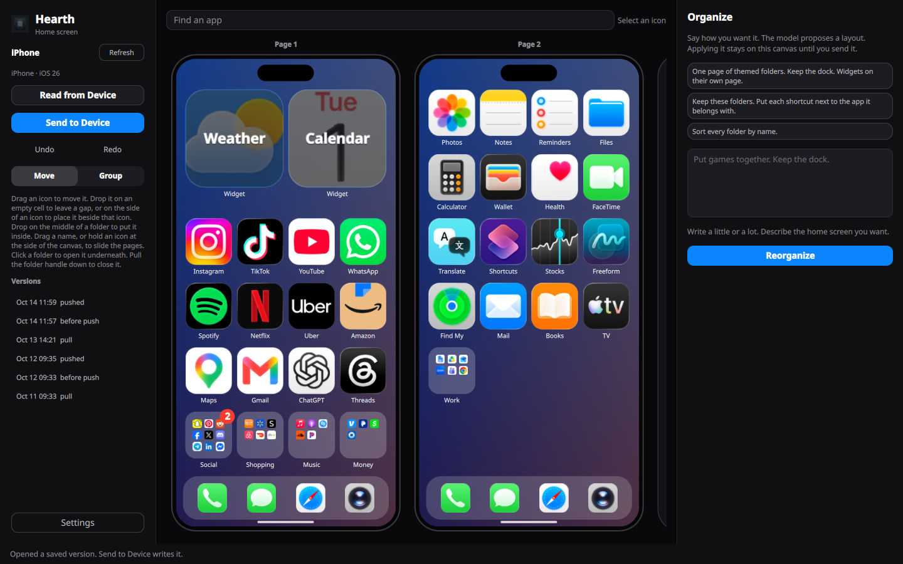
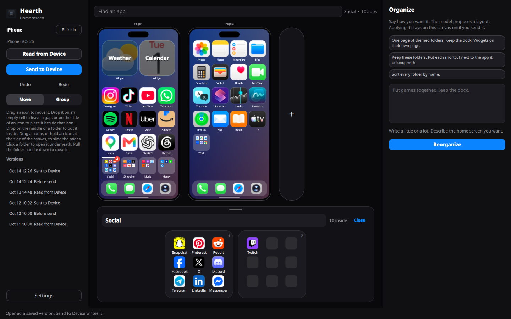
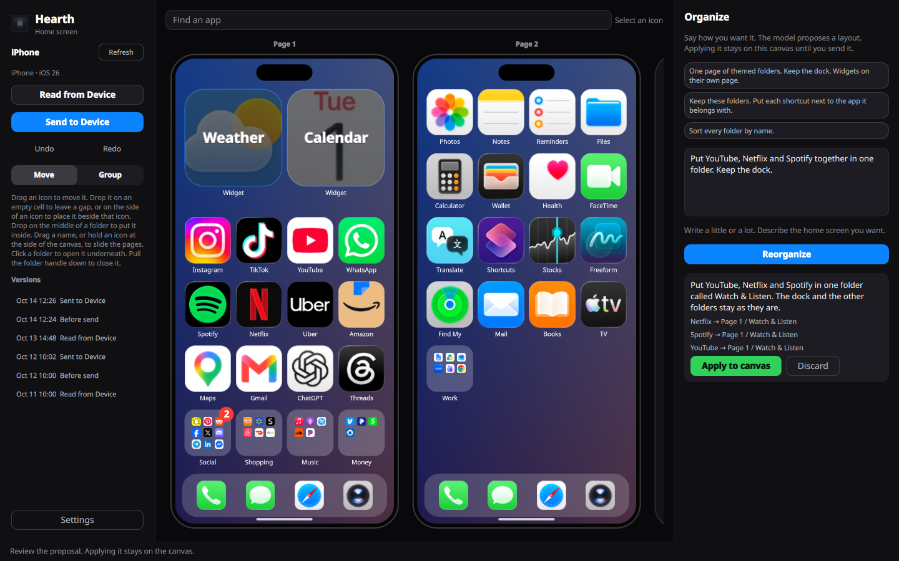
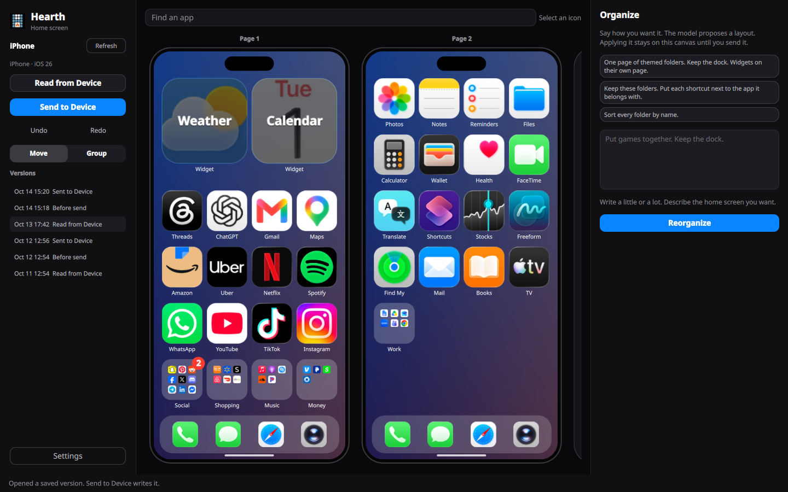

# Hearth

Desktop editor for an iPhone or iPad home screen. Linux, Windows, and macOS.

Plug in one unlocked device. Hearth notices it and reads the layout. Rearrange it, then send it back. Every read and every send saves a version you can open with nothing plugged in.

## Screenshots

Sample home screen. The app icons belong to their owners and are shown only as a demonstration.



Click a folder and it opens along the bottom. A folder with more than one page shows every page.



Describe the home screen you want and Hearth shows what it would move. Nothing changes until you press Apply.



Every read and every send is saved. Open an older version from the list and the canvas shows it, with its icons.



## Install

Releases: https://github.com/helv-io/hearth/releases/latest

| System | File | Run |
| --- | --- | --- |
| Windows | `Hearth-windows.exe` | Download it and double-click. Nothing to unzip. Unsigned, so Windows warns first: choose More info, then Run anyway. The first start takes a few seconds. |
| macOS, M1 or newer | `Hearth-macos.dmg` | Open it and drag Hearth onto Applications. For Macs with an Apple chip, M1 or newer. Unsigned, so the first open needs a few extra clicks, explained below. |
| macOS, Intel | `Hearth-macos-intel.dmg` | The same, for Macs with an Intel processor. |
| Linux | `hearth.flatpak` | `flatpak install --user hearth.flatpak` |

Not sure which Mac you have? Click the Apple menu in the top left corner and choose About This Mac. If the window says Chip, followed by a name like Apple M1, M2, M3 or M4, download `Hearth-macos.dmg`. If it says Processor, followed by a name like Intel Core i5, download `Hearth-macos-intel.dmg`. Both need macOS 14.4 or newer.

The first time you open Hearth on a Mac, macOS warns that it cannot check the app, because Hearth is not signed with a paid Apple developer account. Hearth is open source, and you can read what it does. To open it anyway:

- macOS 15 and newer: open Hearth from Applications. The warning only offers Done, so click Done. Then open System Settings, choose Privacy & Security, scroll to the bottom, click Open Anyway next to Hearth, and enter your password. This button appears for about an hour after the warning.
- macOS 14 and older: right-click Hearth in Applications, choose Open, then choose Open again.

You only do this once.

From source:

```bash
python3 -m venv .venv
.venv/bin/pip install -e .
.venv/bin/hearth
```

On Windows those paths are `.venv\Scripts\pip` and `.venv\Scripts\hearth`.

```bash
make test
```

Tests never open a device. The Makefile sets `QT_QPA_PLATFORM=offscreen`.

## Updates and privacy

When Hearth starts, it asks GitHub whether a newer version has been released. If there is one, a small card in the corner says so. Open download page takes you to the newest release in your browser. Not now hides the card until the next start. Skip this version hides it for good, until an even newer version comes out.

Hearth asks every time it starts, and it says nothing when you are offline or GitHub does not answer. That one request to GitHub is the only thing Hearth sends on its own. It has no device information and nothing that identifies you. There is no tracking. Every request says only that it comes from Hearth and which version. Hearth also contacts the model provider you choose, but only when you ask it to organize, and your icon downloads and Grok sign-in use the internet when you use them.

To check right now, open Settings and press Check for updates. It says You're up to date, or shows the same card for the newer version, even one you skipped. If it cannot reach GitHub, it says so and you can try again. That button works even when the startup check is off.

To turn the startup check off, open Settings and clear Check for updates on startup. Hearth never installs anything by itself.

## Connect

Unlock the device and tap Trust. Hearth checks every two seconds. The first time it sees one device, and the canvas has no unsaved edits, it reads the layout. Refresh looks again and does not replace the canvas. Read from Device and Send to Device are the manual steps.

One device at a time. If two are plugged in, Hearth does not guess which one you mean. It tells you to unplug one. Two devices talking at once could send a layout to the wrong phone.

macOS already has the USB service, the program that lets a computer talk to an iPhone or iPad over a cable. Windows and Linux may not. Hearth checks at startup. When the service is missing or stopped, the sidebar says so and one button sets it up.

| System | What Hearth does |
| --- | --- |
| Linux | Installs the USB service if it is missing, and starts it. You may be asked for your password. |
| Windows | Installs Apple's USB driver if it is missing, and starts it. You may be asked to approve it. If it cannot, the sidebar opens the [Apple Devices](https://apps.microsoft.com/detail/9np83lwlpz9k) page in the Store. |
| macOS | Nothing. |

When the setup works you see nothing more. If it fails, the sidebar says what went wrong in plain words, and you can press the button again.

### If the button fails

The sidebar then shows **Show manual steps**. It opens the exact step for your system and a Copy button. Run it once in a terminal, and on Windows in a terminal opened as administrator. Then press the button again.

## Edit

| | iPhone | iPad |
| --- | --- | --- |
| Grid | 4 × 6 | 6 × 5 |
| Dock | 4 apps or shortcuts | up to 15, folders allowed |
| Widgets in the dock | no | no |

Model list and file locations: [docs/devices.md](docs/devices.md).

Pages keep empty cells. Drop an icon on an empty cell and the gap stays. Drop it on the side of another icon and only the icons up to the next gap shift. Send to Device closes gaps, because the device's icon list has no empty cells. The confirm step says so when the canvas has gaps.

Folders stay packed, nine apps to a page. Two or more pages show that count in a red badge on the folder. One page does not.

Drag the icon to move it. Drag the name under it to slide between pages. Move and Group sit under Undo and Redo. In Group, dropping an app on another app makes a folder. Hover over either one for a one-line hint. Hold an icon at the side of the canvas and that page strip scrolls. That works on the home screen and inside the folder drawer. Click a folder to open it along the bottom. Pull the handle down to close it. Escape or a right-click cancels a drag.

## Limits

Many iPhones and iPads ignore a home screen sent from a computer, and have since around iOS 13. A supervised device (one managed by a school, a company, or Apple Configurator) can accept it. After a send, Hearth reads the screen back and puts the previous layout back when the device did not keep the edit.

There is no single path that works on every iPhone.

## Organize

LLM settings start with Grok. Sign in with Grok opens a page in your browser and shows a code to enter there. The button becomes Cancel sign-in while Hearth waits. Cancel, closing Settings, or turning the sign-in down in the browser all stop it, and the rest of Hearth works again straight away. You can start it again at any time. A saved API key still works, and `XAI_API_KEY` is used for Grok when nothing else is saved. The key and the sign-in tokens stay in the user config directory.

Hearth does not choose a model for you. Pick a provider, connect it, and choose a model from its list, either in Organize or in Settings. Hearth remembers your choice. The list is fetched when Hearth starts and when you save Settings, and the last list is kept for when you are offline. Until a model is chosen, Reorganize says what is missing: connect a provider, or pick a model.

Other providers: OpenAI, Anthropic, Google Gemini, Mistral, DeepSeek, Groq, OpenRouter, Ollama, LM Studio, and a custom OpenAI-compatible endpoint. Anthropic uses its Messages API. The rest use chat completions.

The model proposes a layout. Apply puts it on the canvas. Send to Device is a separate step, and it asks first.

Slow models are fine. The answer arrives as the model writes it, and the status line counts the characters so far. Hearth only gives up when the model has gone quiet: for 3 minutes before it starts writing, or for 1 minute once it has started. An answer that keeps coming is never cut off for being slow, apart from a 10 minute limit on the whole thing. A message says plainly where it stopped and for how long. A provider that cannot stream is asked again without streaming. Hearth asks for low reasoning, which is enough for this job and makes models that think first answer sooner. A provider that does not accept that is asked again without it, and Hearth remembers that until you close it.

While Hearth waits, Reorganize becomes Cancel. It stops the request at once, says Cancelled, and the rest of Hearth works again straight away. Closing the window stops it too. Loading the model list in Settings is a short request and gives up after 30 seconds.

## License

GPL-3.0-or-later. The text is in `LICENSE`. pymobiledevice3, which Hearth imports, uses the same license.
